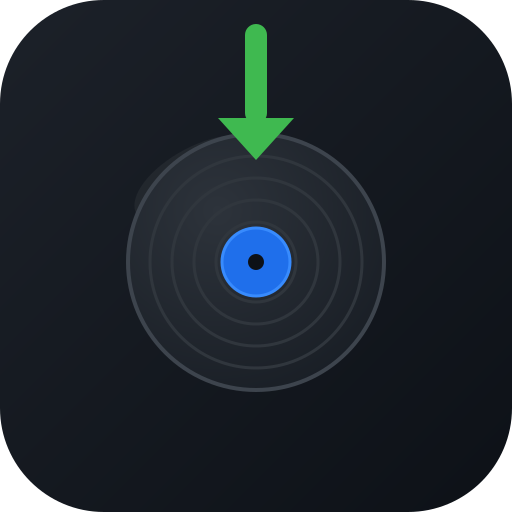

<p align="center">
  
</p>

<h1 align="center">ytmp-dl</h1>

<p align="center">
  Archive your YouTube Music library into a tagged, Plex/PlexAmp-ready music
  tree. Reads your liked songs, history, and playlists; optionally expands
  artists to their full discographies; downloads the best audio YouTube
  serves; then tags everything with canonical MusicBrainz metadata (Spotify
  fallback) — album, track/disc numbers, date, ISRC, genre, cover art.
</p>

```
music/
  Artist Name/
    Album Title (Year)/
      cover.jpg
      01 - Track Title.ogg        # opus/vorbis remuxed from webm, or .m4a/.mp3/.flac
      02 - Track Title.ogg
```

## Features

- **Browser sign-in, no cookie exports** — pulls your YouTube session
  straight from Chrome, Edge, Firefox, Brave, Opera, or Opera GX. Paste a
  `cookies.txt` or JSON cookie export as a fallback.
- **Local web GUI** — stat cards, live progress, job queue, artist/track
  tables, live log console. Binds to localhost only.
- **Selective discovery** — pick exactly what to grab: liked songs, play
  history, your playlists, library songs/albums. Auto-generated mixes
  ("Discover", "Repeat Rewind", …) are skipped by default.
- **Discography on demand** — expand only the artists *you* tick, or all
  library artists, or everything — never silently queues 100k tracks.
- **Best-quality audio** — `yt-dlp` `bestaudio/best`: Opus ~130 kbps in
  WebM, remuxed losslessly to `.ogg` (codec copy, no re-encode). m4a/MP3
  sources are kept as-is. ffmpeg is bundled by the Windows build.
- **Canonical tags** — MusicBrainz matching per track (title + duration +
  album tiebreak), Spotify fallback. ISRC, release dates, disc numbers,
  embedded artwork, plus `cover.jpg` per album folder.
- **Resumable** — everything lives in SQLite (WAL). Interrupts, crashes,
  and re-runs pick up where they left off. Done tracks are never fetched
  twice; duplicate recordings across YouTube uploads are deduped by
  MusicBrainz recording ID.
- **Cookie-resilient downloads** — yt-dlp tries *without* cookies first
  and only uses your session as a fallback, so downloads keep working
  after the cookies expire.

## Requirements

- **Windows**: nothing — `windows\install.bat` installs Python 3.13,
  dependencies, and ffmpeg for you, then builds a self-contained
  `dist\ytmp-dl.exe`.
- **Manual / Linux / macOS**: Python 3.10+, `ffmpeg`/`ffprobe` on PATH
  (or in `bin/` next to the project), and a modern browser for sign-in.

## Windows — one-click install

1. Download and extract the source zip somewhere, e.g. `C:\ytmp-dl`.
2. Double-click **`windows\install.bat`**. It will:
   - silently install Python 3.13 if missing (no clicks),
   - create a venv and install dependencies,
   - download ffmpeg (~80 MB, one time),
   - build `dist\ytmp-dl.exe` with PyInstaller,
   - copy ffmpeg into `dist\bin\` next to the exe,
   - create a **ytmp-dl** desktop shortcut and launch the GUI.
3. In the GUI's **Account** panel click **Sign in** and pick the browser
   you're logged into YouTube Music in. Fully close that browser first —
   its cookie database is locked while running.
4. Use **Options** to choose what to grab, tick artists for discography
   expansion if wanted, then hit **Run All** or **Download**.
5. Point your Plex music library at `dist\music\`.

To rebuild after pulling updates: `windows\build.bat` (venv + ffmpeg are
reused — only the PyInstaller step re-runs, ~2 min).

## Manual install

```bash
python3 -m venv .venv
.venv/bin/pip install -r requirements.txt
cp config.toml.example config.toml    # optional — GUI Options override it
.venv/bin/python -m ytmp_dl gui       # opens http://127.0.0.1:8377
```

Or build the Windows exe yourself:

```bat
windows\build.bat    :: produces dist\ytmp-dl.exe + dist\bin\ffmpeg*
```

## Authentication

YouTube Music has no public API for personal libraries, so the tool uses
your browser session.

- **Sign in (recommended)** — GUI → Account → pick your browser →
  **Sign in**. Cookies are read directly from the browser profile and
  validated against YouTube Music.
- **Paste cookies** — export all cookies for `music.youtube.com` (Netscape
  `cookies.txt` *or* a JSON cookie export) and paste into the Account
  panel.
- **cookies.txt file** — drop a Netscape export at `./cookies.txt`
  (gitignored) and the pipeline picks it up automatically.

> Cookies are secrets — treat them like a password. `cookies.txt`,
> `*.auth.json`, `config.toml`, the database, and `music/` are all
> gitignored and never leave your machine.

## GUI

`http://127.0.0.1:8377` — everything runs as queued background jobs so
the UI stays responsive.

- **Actions** — Run All, Auth, Discover, Artists, Discography, Download,
  Retry Failed, Fix .webm→.ogg, plus an "add URL / playlist / artist" box.
- **Options — what to grab** — toggles for liked songs, history,
  playlists, library songs/albums; a discography mode selector
  (`selected artists only` / `my library artists` / `all artists` /
  `off`); and "also download discography tracks". Persisted in the DB.
- **Artists tab** — every artist with status, progress bar, and a
  checkbox to include it in discography expansion (`•` = appears in your
  library). Header checkbox selects all.
- **Tracks tab** — every song with status badges, filters
  (status/artist/search), pagination, file paths, errors.
- **Log tab** — live pipeline log; auth and download errors show here.

## CLI

```bash
ytmp-dl discover      # liked songs, history, playlists -> DB
ytmp-dl artists       # resolve artist names -> YTM channels
ytmp-dl discography   # expand artists per the selected mode
ytmp-dl download      # download + tag pending tracks (--limit/--artist/--workers)
ytmp-dl remux         # re-box .webm/.mkv -> .ogg in place + retag
ytmp-dl retry         # reset failed tracks to pending
ytmp-dl status        # progress summary
ytmp-dl add <url|playlist|artist>   # ad-hoc additions
ytmp-dl auth          # build + validate auth from cookies.txt
ytmp-dl gui           # launch the web UI
```

## How it works

- **Discovery** — `ytmusicapi` reads Liked Music, history, and library
  playlists; raw-response fallbacks handle YouTube's changing page
  layouts. Everything upserts into `ytmp_dl.db` immediately, so cookie
  expiry can't interrupt a later download run.
- **Artists** — channel IDs are resolved from track credits or YouTube
  Music search; a raw-page parser covers channel layouts
  `ytmusicapi` doesn't understand yet.
- **Discography** — per-artist album/single/EP shelves plus the "songs"
  tab are expanded into release + track rows.
- **Matching** — lazy, per-track, inside the download workers:
  MusicBrainz recording search → fuzzy title/duration/album scoring →
  Spotify fallback → YouTube Music metadata as last resort. MB failures
  degrade to fallback tags instead of killing the job.
- **Download** — `yt-dlp` `bestaudio/best`, public-first with cookie
  fallback. WebM Opus/Vorbis is remuxed to `.ogg` via `ffmpeg -c copy`
  (lossless); other containers pass through.
- **Tagging** — mutagen writes Vorbis comments (ogg/opus), MP4 atoms
  (m4a), ID3 (mp3), or best-effort WebM tags, plus embedded artwork.
- **State** — SQLite WAL + busy-retry; safe for concurrent GUI/API
  access and duplicate exe instances degrade gracefully.

## Config

`config.toml` (see `config.toml.example`) — everything also settable from
the GUI Options panel, which stores overrides in the DB:

| section | key | default | meaning |
|---|---|---|---|
| discover | include_liked / include_history / include_library_playlists | true | library sources |
| discover | include_library_songs / include_library_albums | false | extra library sources |
| discography | mode | `selected` | selected / library / all / off |
| download | include_discography | false | also fetch album:/songs bulk |
| download | workers | 2 | parallel downloads |
| metadata | musicbrainz / spotify | true | metadata providers |
| spotify | client_id / client_secret | "" | optional fallback keys |

## Troubleshooting

- **"ffmpeg/ffprobe not found"** — put `ffmpeg.exe` + `ffprobe.exe` in
  `dist\bin\` (next to the exe), in `bin\` at the project root, or on
  PATH, then rebuild/restart. The Windows installer does this for you.
- **`.webm` files in `music\`** — remux didn't run (ffmpeg missing at
  download time). Fix ffmpeg, then run **Fix .webm→.ogg** (or
  `ytmp-dl remux`) to convert existing files in place.
- **Sign-in fails / browser option missing** — fully quit the browser
  (Opera GX lives in the system tray), retry. Opera GX maps to yt-dlp's
  `opera` extractor with its profile path passed explicitly.
- **`database is locked`** — another `ytmp-dl.exe` is running; check Task
  Manager and end extras. The DB retries for 30 s before erroring.
- **Artist resolve warnings** (`musicImmersiveHeaderRenderer`) — YouTube
  layout drift; the raw-page fallback handles it and failed artists
  auto-retry on the next Artists run.
- **Match failures** — transient MusicBrainz errors now log a warning
  and fall back to YouTube metadata; the track still downloads.

## Notes

- Downloads are the best *free* audio YouTube exposes (~128–160 kbps
  Opus/AAC). Premium-only higher-bitrate formats aren't accessible
  without Premium; if they appear later, `bestaudio/best` picks them up.
- Live recordings, remixes, and deluxe pressings stay as their own
  albums — intentional.
- This tool is for archiving content you have the right to download.
  Respect YouTube's Terms of Service and artists' rights.
